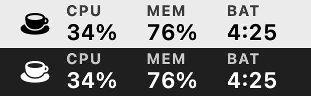
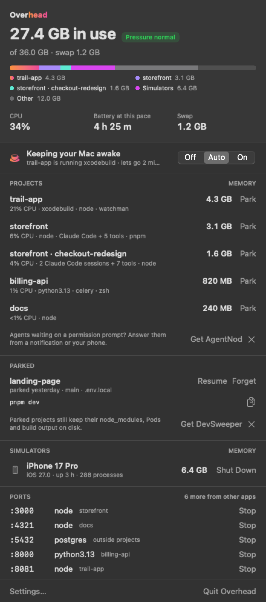
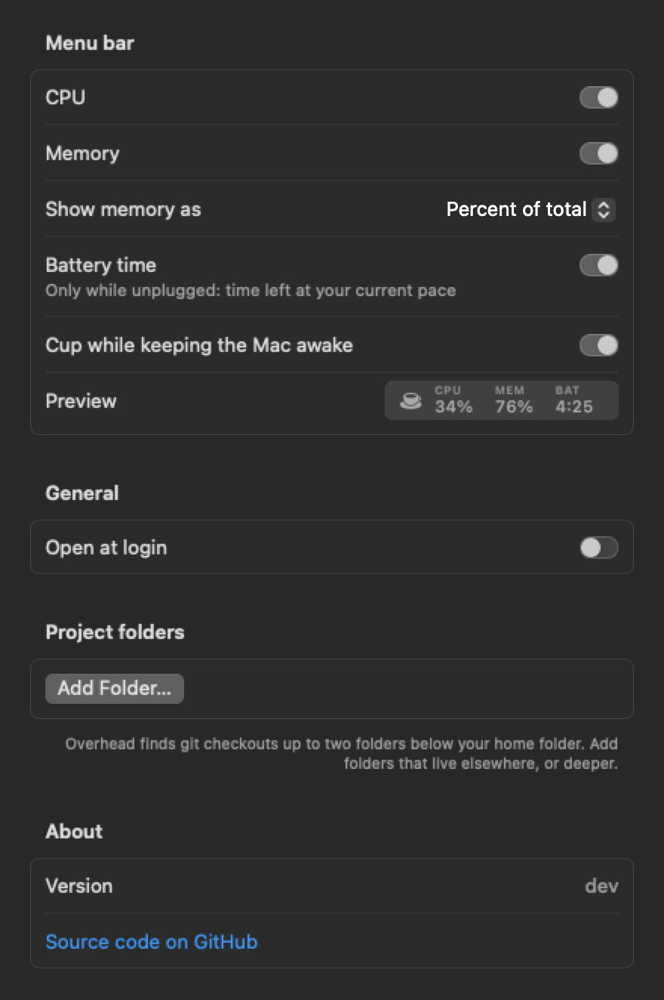
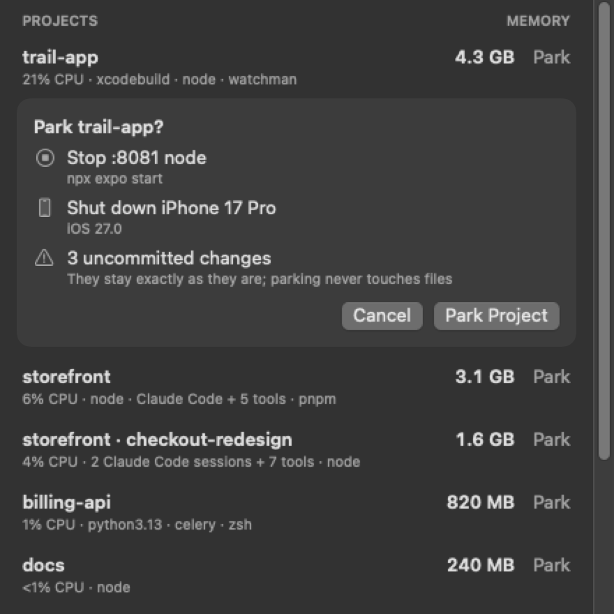

# Overhead

See what each project costs your Mac.

Overhead is a free, open-source menu bar app for developers. Activity Monitor lists hundreds of processes; Overhead
adds them up by the git checkout they run from, so `node`, `xcodebuild` and a Python server show up as one line:
"my-app, 6.1 GB".

<p align="center">
  
</p>

<p align="center">
  
</p>

The projects in these screenshots are made up. `./scripts/screenshots.sh` renders them with `--demo`, which never
reads your own processes.

## Install

Download `Overhead-<version>.dmg` from the [latest release](https://github.com/dimeloper/overhead/releases/latest),
open it and drag Overhead to Applications. It is signed and notarised by Apple, and runs on macOS 14 or later, on
Apple silicon and Intel Macs.

With Homebrew:

```bash
brew install --cask dimeloper/tap/overhead
```

From 0.9, Overhead updates itself: it checks once a day and offers a new version in the popover, and you can turn
that off in Settings. Updates are signed, and Overhead installs only one whose signature matches its own key.

## Status: 0.9, early

Working now:

- A compact menu bar readout, updated every second: CPU and memory as percentages, as small labels over values. On
  battery it adds how long the battery lasts at your current pace. A cup shows while Overhead keeps the Mac awake.
  The popover adds memory pressure and swap.
- Settings (⌘, from the popover): choose which readouts the menu bar shows, memory as a percentage or in gigabytes,
  open at login, and extra project folders beyond the two levels below your home folder.

  
- Memory and CPU per project. A process counts toward the deepest git checkout its working directory is in, so a
  worktree gets its own row. Checkouts are found up to two folders below your home folder, plus agent worktrees in
  `.claude/worktrees/`.
- Battery time at this pace: remaining watt-hours divided by your average draw over the last 10 minutes. It starts
  over when you unplug, so it follows how you work now rather than the last hour.

- Keep awake: Off, On, or Auto. Auto holds while a build tool or coding agent is actually working (above a quarter
  of one core), or while a project is busy, and lets go two minutes after the work stops. An idle agent session or
  a dev server waiting for requests does not keep your Mac up. The display can still sleep, and closing the lid on
  battery still sleeps the Mac. A cup appears in the menu bar while it holds; `pmset -g assertions` lists it as
  "Overhead: <reason>".
- Ports: dev servers listening in your projects, plus databases and Docker running outside them, each with a Stop
  button that sends a polite quit signal (SIGTERM) after you confirm. Other apps' listeners (AirPlay, Spotify) are
  only counted.

- Simulators: every booted simulator with its runtime, when it booted, how many processes it runs, and the memory
  and CPU of all of them together, with a Shut Down button (`xcrun simctl shutdown`; the device and its data stay).
  A booted iOS simulator runs close to 300 processes, so an idle one left open for a day can hold many gigabytes,
  much of it compressed or in swap.

- Park a project when you are done with it for now. Park first shows what it will do, then stops the project's dev
  servers (a polite quit signal to the server's process group, never your shell's) and shuts down the simulators
  running the project's app, matched by bundle identifier. It never stops coding agents and never touches files; it
  tells you about uncommitted changes. It keeps a setup sheet: branch, the commands that started the servers, the
  simulators, and the names of your `.env` files (never their contents). Resume boots the simulators, opens the
  folder in Terminal, and gives you each command to copy. Servers are not restarted for you, because they would miss
  the environment your shell gives them.

  

CPU per project is also the best guide to which project drains the battery: macOS does not report power per
process. Memory per project and per simulator is the sum of each process's footprint, the figure Activity Monitor
shows; it includes compressed memory, so the parts can add up to more than "in use".

## Build

Requires macOS 14 or later and Xcode 15 or later.

```bash
swift test                  # OverheadCore tests
./scripts/build-app.sh      # builds build/Overhead.app
open build/Overhead.app
build/Overhead.app/Contents/MacOS/Overhead --snapshot popover.png --full   # renders the popover to a PNG
./scripts/screenshots.sh    # regenerates the README screenshots from made-up projects
./scripts/release.sh        # universal, Developer ID signed and notarised DMG (needs your own certificate)
```

A release: bump the version in `scripts/Info.plist`, write `docs/release-notes/<version>.md`, commit and push, then
run `scripts/release.sh` and `scripts/publish-release.sh`. The second tags the commit, uploads the DMG and a signed
update feed (`appcast.xml`) to GitHub Releases, checks both uploads, and updates the Homebrew cask. Signing the feed
needs the update key in your keychain (`generate_keys --account overhead`, from Sparkle). `--dry-run` shows what it would do.

## Privacy

Overhead reads process names, memory figures and working directories on your Mac. It sends nothing anywhere: no
account, no analytics. Its only network request is the update check, which downloads `appcast.xml` from this repo's
latest GitHub release once a day. The request names Overhead and its version, as any app's user agent does; system
profiling is off. Turn checking off in Settings.

## From the same developer

- [DevSweeper](https://devsweeper.com): finds disk space you can safely reclaim from caches, build output,
  simulators and old worktrees.
- [AgentNod](https://agentnod.app): answer your coding agents' permission prompts from a HUD, a notification or your phone.

## License

MIT. See `LICENSE`.
